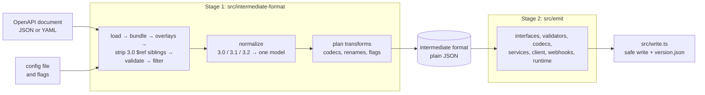

# Architecture: open-api-gen

open-api-gen turns an OpenAPI document into a TypeScript client: generated types and services, plus a hand-written runtime copied into every client. It is a build-time tool and a library. It is not an HTTP server, a mock server, or a documentation renderer, and it makes no network requests itself. Usage is in [README.md](README.md).

## Why this design

**Two stages joined by one data format.** Stage 1 makes every decision: which declaration a schema becomes, its final TypeScript name, which service an operation belongs to, which values a transform changes, and which declarations need validators. Stage 2 only formats those decisions as source text and never sees the OpenAPI document, its version, `$ref`s or the config. The alternative, emitting code while walking the document, mixes the 3.0/3.1/3.2 differences, naming, transform rules and code formatting in one place, so a change to any of them can break the others.

- **Separate tests.** Stage 2 tests start from golden intermediate-format files (`test/golden/intermediate-format/`), so they keep passing while Stage 1 changes, and a Stage 1 change shows up as a reviewable diff of those files.
- **Inspectable.** The intermediate format is plain JSON (`--emit-intermediate-format`), and library users can change it between `buildIntermediateFormat` and `emit`.
- **Checked boundaries.** `test/boundaries.test.ts` fails when a file under `src/emit/` imports anything but types from `src/intermediate-format/`. `src/intermediate-format/intermediate-format.schema.json` is generated from `src/intermediate-format/types.ts`, every Stage 1 output in the tests validates against it, and `make lint` fails while the schema is stale.

**One hand-written runtime instead of generated logic.** Generated validators and codecs are small expressions, such as `object({ id: { required: true, validator: number(true, {}) } })`, over runtime modules the generator copies into every client (`src/emit/runtime/`). Those modules are ordinary TypeScript in this repository, type-checked and tested directly. `scripts/embed-runtime.ts` embeds their text into `src/emit/runtime-sources.ts`, so the published package copies them without reading its own source tree, and `make lint` fails while that file is stale. Generating a checking routine per schema would need its own tests per schema; `test/validators.test.ts` instead compares the generated validators with `@hyperjump/json-schema` on sample values.

**Bundling first.** External `$ref` files are bundled into one document right after loading. Overlays, validation, filtering, normalize and the written `open-api.json` therefore see a single document with local references only, and `refs.ts` stays a local resolver. A target referenced from a schema, parameter, response or similar position is hoisted into `components` once, named after its file or pointer. Resolving references in place would give a schema used in ten places ten inline copies, and ten generated types named after their positions.

Spec validation uses `@hyperjump/json-schema` because ajv 8.20 rejected valid 3.1 and 3.2 documents: the OpenAPI `schema-base` schemas rely on `$dynamicRef`, and in a probe ajv reported `unevaluatedProperties` failures for a minimal valid document that hyperjump accepted.

## How it works

### Stage 1 modules

| Module | Owns |
|---|---|
| `config.ts` | the config file, flags, defaults and their validation |
| `load.ts` | reading JSON/YAML and detecting the 3.x version |
| `bundle.ts` | external `$ref` files: hoisting into `components`, the reference-root check |
| `overlay.ts` | OpenAPI Overlay 1.0 to 1.2 (RFC 9535 JSONPath via `jsonpath-rfc9535`) |
| `validate-spec.ts` | validation against the official schemas, and stripping 3.0 `$ref` siblings |
| `filter.ts` | operation filters and pruning of unused components |
| `refs.ts` | local `$ref` resolution |
| `normalize.ts` | every difference between 3.0, 3.1 and 3.2: declarations, names, services, operations, security, servers, webhooks and callbacks |
| `naming.ts` | PascalCase, camelCase and kebab-case rules |
| `transform-plan.ts` | codecs, property renames, and the `transformed` and `runtime` flags |
| `build.ts` | the Stage 1 pipeline |

### Stage 2 and the generated client

| Module | Emits |
|---|---|
| `interfaces.ts` | one interface or type per declaration, wire and App shapes |
| `validators.ts`, `codecs.ts` | validator and wire ↔ App converter expressions |
| `services.ts` | one service class per tag; each method passes an operation descriptor to `runtime/service.ts` |
| `read-write.ts` | `interface/read-write.ts`, the request and response variants of schemas with required `readOnly` or `writeOnly` properties |
| `client.ts`, `servers.ts` | `client.ts`: servers, security schemes, `createClient`, `ApiErrors`, `isApiError` |
| `webhooks.ts` | `webhooks.ts`: payload types and `parseWebhook` |
| `index.ts` | the package entry `index.ts`: services, wire types and the runtime API, with explicit runtime exports that win over a schema of the same name |

Every method delegates to `callOperation`: encode the body, validate the request, call `send`, validate the response, decode. That sequence is written and tested once in the runtime instead of once per operation.

- **References are lazy** (`lazy(() => validatePet)`), so recursive schemas and import cycles between generated modules evaluate safely.
- **Runtime imports are namespaced.** `runtime/validation.ts` and `runtime/transform.ts` both export `array` and `lazy`, so files using both import them as namespaces (`validation.array`, `transform.array`). Service files import the service and fetch runtimes as `serviceRuntime` and `fetchRuntime`: declaration names are PascalCase, so a schema named `ApiError`, `RequestOptions` or `ServiceConfig` cannot clash with them (`test/fixtures/errors-3.1.yaml` holds such schemas).
- **Types follow `transform`.** Each service class is generic over a boolean type parameter that TypeScript infers from `transform: true`, and its methods return `Transform extends true ? AppType : WireType`.
- **Per-call options come last.** Every method ends with an optional `options` argument. A trailing argument keeps the dist3 positional parameters where they are; folding all arguments into one object would break every call site written against dist3. The options reach a custom `send` as `SendRequest.options`.
- **`createClient` is data plus one runtime call.** The generated `client.ts` lists the document's servers, security schemes and services; option handling lives in `runtime/client.ts` and is tested once. Stage 1 decides each service's client property (`pets` for `PetsService`) and rejects two tags that map to the same one.
- **Operation servers travel in the descriptor.** An operation's own `servers`, else its path item's, replace the client's `baseUrl`, as the specification orders; the descriptor carries the first server and the transport fills its variable defaults. A client-wide override would also redirect operations that live on another host, such as an upload service, so the override is per call.
- **Auth follows each operation's requirements.** Stage 1 resolves the effective `security` of each operation into alternatives of scheme names, and the transport applies the first alternative whose credentials are all configured. One global `Authorization` header would also go to operations marked `security: []`, and it could not express API keys in queries or cookies, or two keys an operation needs together. An unsatisfied requirement still sends the request, because failing early would reject calls to servers that do not enforce the documented requirement.
- **Typed errors through a checked guard.** A rejected Promise has no type in TypeScript, so methods cannot declare their errors. `isApiError(error, operationId)` compares the `operationId` that `ApiError` carries, so the narrowing rests on a runtime check instead of a cast; Stage 1 makes operationIds unique across operations, webhooks and callbacks.
- **Validators know the direction.** A required `readOnly` property comes only from the server, and a required `writeOnly` one only from the client; a validator that ignored this would reject valid bodies that leave such properties out. Each validator receives the direction, and the object rule skips those `required` checks. Request bodies are checked after encoding, in the wire form the schema describes.
- **Read/write variants are named types on top of the declared ones.** Method signatures use `Account$Request` and `Account$Response` from `interface/read-write.ts`, such as `Omit<Account, 'id'> & { id?: Account['id'] }`, so the interface files stay one per schema and match dist3. Each variant exists once per API, and nested schemas refer to each other's variants by name. Inlining the variants into method signatures expanded shared schemas once per path, and generating the Stripe spec that way did not finish within ten minutes (measured on 2026-11-06); the declarations that need a variant are found in one pass, following references backwards from those holding a relaxed property.
- **Webhooks and callbacks become payload parsers, not services.** The client receives these requests instead of sending them, so service methods for them would offer calls that make no sense. `parseWebhook` reuses the response machinery: lossless JSON, validators in the response direction (the API is the sender), codecs.

### The transport

- **A `Request` per attempt.** `createFetchSend` builds a standard `Request` for every attempt and passes it to `fetch`. Middleware can replace it with plain fetch APIs (`new Request(request, { headers })`), credential functions run again, and the timeout restarts; the encoded body (string, `FormData`, `Blob` or bytes) is reusable across attempts.
- **Retries repeat only idempotent methods by default.** Repeating a `POST` or `PATCH` after a lost answer could perform it twice. The defaults are `GET`, `HEAD`, `OPTIONS`, `PUT`, `DELETE` and `QUERY`, on network errors, timeouts and the statuses 408, 429, 500, 502, 503 and 504; a `Retry-After` header replaces the backoff, capped by `maxDelay`, and the caller's own abort is never retried.
- **Abort errors come from the signal.** The Fetch standard rejects an aborted fetch with the signal's reason, a `TimeoutError` for `AbortSignal.timeout`, and Chromium, Firefox, Node.js and Bun do so. WebKit 27.2 rejects with a generic `AbortError` instead, found by the browser e2e and confirmed in a probe. The transport therefore throws the signal's reason whenever the attempt's signal has fired, so a timeout is a `TimeoutError` in every engine.
- **Exact int64 values** rely on the `JSON.parse` reviver's source text for reading and `JSON.rawJSON` for writing. Node.js 24.20, Bun 1.3.9, Chromium 158, Firefox 159 and WebKit 27.2 provide both, as `make test` (Bun) and `make e2e` (Node.js and the browsers) check. Without them, the `bigint` codec throws a `TransformError` for a rounded value instead of passing it on, and sending a value beyond 2^53 throws a `RangeError`.

## Operations

- **Configuration and policy:** `src/intermediate-format/config.ts` owns every key; unknown keys and wrong types fail before any work, and config file paths are resolved relative to the file. The generator reads no environment variables.
- **Complexity and resources:** generation runs in memory, in one process. In `make e2e`, the GitHub spec (276 webhooks, 22,995 generated files and folders) generates in about 7 s and Stripe in about 4.6 s; `make bench` prints the stage timings on the Jira spec. `intermediate-format.json` for GitHub is 40 MB.
- **Third-party integrations:** the runtime dependencies are `@hyperjump/json-schema` 1.18.0, `jsonpath-rfc9535` 1.3.0 and `yaml` 2.9.1, pinned exactly; generated clients depend on nothing.
- **Testing:** `make test` runs against real subsystems: generated code written to `tmp/` and imported, a live `Bun.serve` server, and the TypeScript compiler. `make e2e` packs the package, installs the tarball into a clean project with TypeScript 7.0.2, generates every spec in `examples/` with Node.js, type-checks each client with `strict` and `nodenext`, and runs `input/smoke.ts` against a Node.js mock server. `scripts/browser-e2e.ts` then bundles `input/browser-smoke.ts` with the generated clients and runs it in headless Chromium, Firefox and WebKit (Playwright) against a same-origin mock API, writing `output/browser-report.json`.
- **Observability:** the CLI writes one line per event, an ISO 8601 UTC timestamp first, then the level and the message: `INFO` to stdout, `WARN` and `ERROR` to stderr. `version.json` in the output keeps the effective config and every warning with a JSON Pointer into the input.
- **Generated files:** `make intermediate-format-schema` and `make runtime-sources` regenerate the two checked-in generated files.

## Security and privacy

- **Untrusted input:** the OpenAPI document, overlays and config are untrusted input. Every identifier, string literal, comment and import path from them reaches generated code through `src/emit/names.ts` (`quote`, `propertyKey`, `docComment`, `identifier`); `test/names.test.ts` parses the output of hostile names and descriptions and checks that each stays one literal, member or comment. Spec values that are not numbers, booleans or strings are dropped from validator constraints instead of being pasted into code.
- **Reference root:** external `$ref` files must lie in the input document's directory or below, or below `--ref-root`, compared on real paths so a symbolic link cannot lead outside. The referenced files end up in the written `open-api.json`, so an untrusted document must not pull arbitrary local files (`../../.ssh/…`) into output that may be published. URLs are refused.
- **No data loss:** `src/write.ts` writes only into an empty directory or one holding earlier open-api-gen output. It recognizes that output by the generated-file header and by `version.json`, deletes only stale files it created, and stops at any other file unless `--force` is given; with `--force` a hand-written file at a generated path is overwritten, never one elsewhere. A symbolic link inside the directory stops the run, so nothing outside it is written.
- **No network or secrets in the generator:** it makes no network requests and reads no environment variables.
- **Generated client:** it sends the parameters and bodies the caller passes, plus the headers and `auth` credentials the caller configures, and middleware runs only code the caller supplies. Credentials stay in memory, are not logged, and go only to the operations whose security requirements name their scheme. `parseWebhook` does not verify webhook signatures; the receiving server must do that before parsing.
- **Privacy:** the generator reads API descriptions, which may hold contact details such as `info.contact`, and copies them only into the files it writes (`open-api.json`, `open-api.yaml`, `intermediate-format.json`, doc comments). Data the generated client sends or receives is the caller's; the client stores nothing and has no telemetry.
