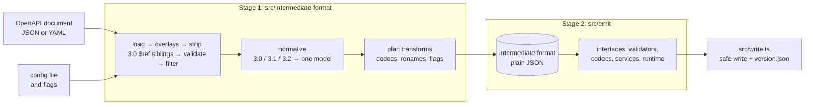

# Architecture

open-api-gen turns an OpenAPI document into a TypeScript client in two stages joined by one data format.

## Why two stages

Stage 1 makes every decision: which declaration a schema becomes, its final TypeScript name, which service an operation belongs to, which values a transform changes, and which declarations need validators. Stage 2 only formats those decisions as source text and never sees the OpenAPI document, its version, `$ref`s or the config.

The alternative, emitting code while walking the document, mixes the 3.0/3.1/3.2 differences, naming, transform rules and code formatting in one place, so a change to any of them can break the others.

- **Separate tests.** Stage 2 tests start from golden intermediate-format files (`test/golden/intermediate-format/`), so they keep passing while Stage 1 changes, and a Stage 1 change shows up as a reviewable diff of those files.
- **Inspectable.** The intermediate format is plain JSON (`--emit-intermediate-format`), and library users can change it between `buildIntermediateFormat` and `emit`.
- **Checked boundaries:**
  - `test/boundaries.test.ts` fails when a file under `src/emit/` imports anything from `src/intermediate-format/` other than its types.
  - `src/intermediate-format/intermediate-format.schema.json` is generated from `src/intermediate-format/types.ts`, every Stage 1 output in the tests validates against it, and `make lint` fails while the schema is stale.

## Stage 1 modules

| Module | Owns |
|---|---|
| `config.ts` | the config file, flags, defaults and their validation |
| `load.ts` | reading JSON/YAML and detecting the 3.x version |
| `overlay.ts` | OpenAPI Overlay 1.0 to 1.2 (RFC 9535 JSONPath via `jsonpath-rfc9535`) |
| `validate-spec.ts` | validation against the official schemas, and stripping 3.0 `$ref` siblings |
| `filter.ts` | operation filters and pruning of unused components |
| `refs.ts` | local `$ref` resolution |
| `normalize.ts` | every difference between 3.0, 3.1 and 3.2; declarations, names, services, operations |
| `naming.ts` | PascalCase, camelCase and kebab-case rules |
| `transform-plan.ts` | codecs, property renames, and the `transformed` and `runtime` flags |
| `build.ts` | the Stage 1 pipeline |

VERIFIED: spec validation uses `@hyperjump/json-schema`, because ajv 8.20 rejected valid 3.1 and 3.2 documents. The OpenAPI `schema-base` schemas rely on `$dynamicRef`, and in a probe ajv reported `unevaluatedProperties` failures for a minimal valid document, which hyperjump accepted.

## Stage 2 and the generated runtime

The generated validators and codecs are small expressions, for example `object({ id: { required: true, validator: number(true, {}) } })`, built from runtime modules that the generator copies into every client (`src/emit/runtime/`). Those modules are ordinary TypeScript in this repository, type-checked and tested directly, and `scripts/embed-runtime.ts` embeds their text into `src/emit/runtime-sources.ts` so the published package can copy them without reading its own source tree; `make lint` fails while that file is stale. Keeping the JSON Schema semantics in one hand-written runtime avoids generating and testing a separate checking routine for every schema; `test/validators.test.ts` compares the generated validators with `@hyperjump/json-schema` on sample values.

- **References are lazy** (`lazy(() => validatePet)`), so recursive schemas and import cycles between generated modules evaluate safely.
- **Namespaced runtimes:** `runtime/validation.ts` and `runtime/transform.ts` both export `array` and `lazy`, so files that use both import them as namespaces (`validation.array`, `transform.array`).
- **Types follow `transform`:** each service class is generic over a boolean type parameter that TypeScript infers from `transform: true`, and its methods return `Transform extends true ? AppType : WireType`.
- **Per-call options come last:** every method ends with an optional `options` argument (`signal`, `timeout`, `headers`, `retry`, `onResponse`). A trailing argument keeps the dist3 positional parameters where they were. Folding all arguments into one object would break every existing call site. The options also reach a custom `send` as `SendRequest.options`.
- **Retries repeat only idempotent methods by default:** repeating a `POST` or `PATCH` after a lost answer could perform it twice. The defaults are `GET`, `HEAD`, `OPTIONS`, `PUT`, `DELETE` and `QUERY`, on network errors, timeouts and the statuses 408, 429, 500, 502, 503 and 504. A `Retry-After` header replaces the backoff, capped by `maxDelay`. The caller's own abort is never retried.
- **Middleware sees `Request` objects:** `createFetchSend` builds a standard `Request` per attempt and passes it to `fetch`. Middleware can then replace it with plain fetch APIs (`new Request(request, { headers })`), and a token refreshed in `onRequest` applies to each retry.
- **Validators know the direction:** a required `readOnly` property comes only from the server, and a required `writeOnly` one only from the client. A validator that ignored this would reject every valid request body or response body holding such a property. Each validator therefore receives the direction and the object rule skips those `required` checks. Request bodies are checked after encoding, in the wire form the schema describes.
- **Read/write variants are named types, built on the declared ones:** method signatures use `Account$Request` and `Account$Response` from `interface/read-write.ts`, for example `Omit<Account, 'id'> & { id?: Account['id'] }`. The interface files stay one per schema and match dist3. Each variant exists once per API, and nested schemas refer to each other's variants by name. A first version inlined the variants into method signatures and expanded shared schemas once per path; generating the Stripe spec did not finish within ten minutes. The declarations that need a variant are found once, by following references backwards from those holding a relaxed property.
- **Operation servers travel in the descriptor:** an operation's own `servers` (else its path item's) replace the client's `baseUrl`, as the specification orders. The descriptor carries the first server and the transport fills its variables with their defaults. A per-call `baseUrl` overrides it. A client-wide override would also redirect operations that live on another host, such as an upload service.
- **Auth follows the document's requirements per operation:** Stage 1 resolves each operation's effective `security` (its own, else the document's) into alternatives of scheme names, and the transport applies the first alternative whose credentials are all configured. One global `Authorization` header would also go to operations marked `security: []`, and it could not handle API keys in queries or cookies, or two keys an operation needs together. When no alternative is satisfied the request still goes out. Failing early would reject calls to servers that do not enforce the documented requirement. Credentials are resolved per attempt, so a refreshed token reaches retries.
- **Typed errors through a checked guard:** a rejected Promise has no type in TypeScript, so methods cannot declare their errors. `isApiError(error, operationId)` compares the `operationId` that `ApiError` carries, so the narrowing rests on a runtime check instead of a cast. Keying by operationId works because Stage 1 makes operationIds unique.
- **Runtime imports in service files are namespaced** (`serviceRuntime.callOperation`, `fetchRuntime.ApiError`). Declaration names are PascalCase, so a schema named `ApiError`, `RequestOptions` or `ServiceConfig` cannot clash with them. `test/fixtures/errors-3.1.yaml` holds such schemas.
- **`createClient` is data plus one runtime call:** the generated `client.ts` lists the document's servers and services. Option handling lives in `runtime/client.ts` and is tested once. Stage 1 decides each service's client property (`pets` for `PetsService`) and rejects two tags that map to the same one.

VERIFIED: lossless int64 parsing relies on the JSON.parse reviver's source text, and writing a bigint relies on `JSON.rawJSON`. Probes on Node.js 24.20 and Bun 1.3.9 confirmed both. Without them, `bigint` refuses rounded values instead of passing them on, and sending a value beyond 2^53 throws. The test suite runs on Node.js and Bun only; no browser has been tested.

## Operations

- `make test` runs the unit and integration tests against real subsystems: generated code written to `tmp/` and imported, a live `Bun.serve` server, and the TypeScript compiler.
- `make e2e` packs the package, installs the tarball into a clean project with TypeScript 7.0.2, generates every spec in `examples/` with Node.js, type-checks each client with `strict` and `nodenext`, and compiles and runs `input/smoke.ts` against a Node.js mock server; results land in `output/`.
- `make bench` prints the stage timings on the Jira spec.
- `make intermediate-format-schema` and `make runtime-sources` regenerate the two checked-in generated files.

## Security and privacy

- **Untrusted input:** the OpenAPI document, overlays and config are untrusted input. Every identifier, string literal, comment and import path from them reaches generated code through `src/emit/names.ts` (`quote`, `propertyKey`, `docComment`, `identifier`); `test/names.test.ts` parses the output of hostile names and descriptions and checks that each stays one literal, member or comment. Spec values that are not numbers, booleans or strings are dropped from validator constraints instead of being pasted into code.
- **No data loss:** `src/write.ts` writes only into an empty directory or one holding earlier open-api-gen output. It recognizes that output by the generated-file header and by `version.json`, deletes only stale files it created itself, and stops at any other file unless `--force` is given; with `--force` a hand-written file at a generated path is overwritten, never one elsewhere. A symbolic link inside the directory always stops the run, so nothing outside it is written.
- **No network or secrets:** the generator makes no network requests and reads no environment variables; the generated `createFetchSend` sends only the headers the caller configures, and middleware runs only the code the caller passes in.
